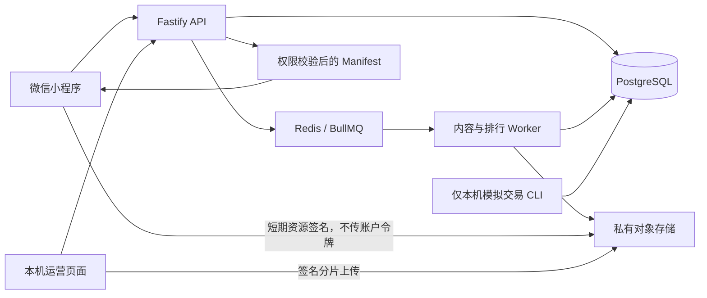

# 听阅小程序：技术架构与需求总览 v6.0

> 更新日期：2026-10-12
> 文档状态：当前本地技术与验收基线，替代 v5.0 作为首要阅读入口。
> 代码基线：`peter@c4daa5f`，已合并 `backend/v1@e75106a`。
> 发布状态：内测开发；尚未生产上线、未接入真实收款。
> 本次仅更新本地文档，不提交或推送 GitHub。

## 1. 当前结论：代码与运行环境分开记录

前后端代码已经合并，新增学员资料、原始字幕导入、上传恢复、运营控制和批量导入，与原有学习同步、积分、模拟收费及正文阅读兼容。最新回归中没有发现遗留合并标记或功能冲突，但测试通过不等于生产发布批准。

| 项目 | 最新代码／隔离验收 | 现有本机用户环境 |
| --- | --- | --- |
| API 契约 | `api-contract-v2.9.0` | 实际运行 `api-contract-v2.9.0`，健康检查 200 |
| 数据库 | 21 条迁移；临时库 49 个表/视图条目 | 已应用 21 条迁移；新增 4 条全部完成 |
| 学习及收费 | 学习、排行、内容权限和模拟交易均保留 | API/worker 可用，原有学习及订单事实已核对保留 |
| 新增模块 | 学员资料、恢复上传、运营及批量导入已通过隔离验收 | 已部署；学员保存/幂等、运营/批量接口及角色拒绝检查通过 |
| 内容 | 七资源内容包、动态目录、版本切换及回滚 | Peter 内部 v2 为当前测试版本；旧 v1 保留历史 |
| 客户端构建 | 正式主包 12 页＋Quiz 子包 1 页；Demo 主包 15 页＋子包 1 页 | 专用本机项目已重建：主包 12 页＋子包 1 页 |
| 自动测试 | 客户端 216/216，后端 119/119，13 组集成检查通过 | 用户已确认模拟器首页和其他主要功能正常；订单正文有既有授权测试入口 |

页数按 `app.json` 的主包与子包分别统计，避免混用主包页数、路由数量和历史构建数字。2026-10-12 已完成现有用户库升级、API/worker 重启和专用项目重建；真实 API/S3 页面联合回归通过。新扫码预览上传遇到微信工具 TLS 错误，尚未取得新版二维码。

## 2. 产品范围与已知限制

当前可验收主流程为 Home / Recent / Me、目录、听读、词卡、生词、Quiz、云报告、排行及账户同步。Peter Rabbit 候选素材包含 322.026 秒音频、59 条字幕、358 个词义和 10 道 Quiz。

真实借阅、库存、优惠券、邀请和正式商品运营没有完成生产业务闭环。相关演示仍属于 Demo；是否进入下一正式开发阶段需单独确定，不能把历史计划中的目标当作已交付功能。

用户当前选择：账号自行持有、暂不购买云服务器等资源，Android 验收暂缓。微信中测试音源可播放的用户确认，不覆盖 Safari、后台锁屏、所有网络或全部手机兼容性。

本机身份仍为明确标记的模拟微信身份。真实 `code2Session`、稳定 HTTPS、主体/类目、支付资格、内容权利、隐私及生产运维需分别验收。源 Peter 候选包的发布门槛没有因为内部测试版本而关闭。

## 3. 技术栈与进程

| 层次 | 实现 | 主要职责 |
| --- | --- | --- |
| 微信小程序 | JavaScript、WXML、WXSS、微信原生 API | 页面、全局播放、学习操作、同步与临时正文 |
| 后端 API | TypeScript、Node.js 24+、Fastify 5 | 会话、契约、权限、学习写入、内容与运营控制 |
| 后台 worker | TypeScript、BullMQ | 资源校验、派生字幕、恢复调度、排行重建 |
| 数据库 | PostgreSQL 16、`pg`、SQL 迁移 | 可信事实、版本、事件、回执、角色与审计 |
| 队列 | Redis、BullMQ | 任务分发、锁、故障恢复和代次控制 |
| 存储 | 私有 S3 兼容对象存储，本机 AIStor | 原始与派生资源、分片上传、短期签名 URL |
| 运营页面 | `operations-web/` 的 HTML/CSS/JavaScript | 本机授权管理员的导入、恢复、重试与取消 |
| 验证工具 | Node test runner、TypeScript、Playwright/Edge、微信开发者工具 CLI、ffprobe | 自动回归、真实依赖联调、原生编译及音频探测 |



数据库和服务端判断金额、内容版本、权限、成绩与积分。客户端显示和本机缓存不能自行证明支付成功、完成学习或可信排行。

## 4. 听读、目录与资源版本

目录从服务端读取已发布作品和篇目，支持搜索、分类与分页，不依靠打包列表发现新书。未知字段保持未知，不编造页数、级别或词数。

新版完整内容包为七种资源：audio、cover、text、subtitles、vocabulary、quiz、metadata。客户端核对清单摘要、各资源 SHA-256、大小、身份、版本和字幕/题目结构后才使用；音频时长由真实探测结果提供。

播放器采用全局会话，支持跨页保持、暂停续播、倍速和可信断点。唯一覆盖区间去重；完成需要自然结束、至少 90% 覆盖及末尾 3 秒已听，拖到结尾不构成完成。词卡打开暂停，关闭仅在原会话和条件允许时恢复。

音频签名过期后先重新验证身份与权限再续期，保持位置、倍速、覆盖与暂停意图；切换账号/篇目后丢弃迟到回复。权限或版本拒绝不能通过重播旧地址绕过。

本机 Peter v1 为旧六资源内部夹具。升级创建独立 v2 七资源包，旧资源、题包和记录不覆写；旧成绩按兼容性显示历史，不伪装为 v2 成绩。新版本断点不能直接冒充旧版本断点。

## 5. 学习同步、云报告与排行

| 模块 | 当前规则 |
| --- | --- |
| S-01 本机导入 | 用户明确同意，规范化快照、幂等提交；服务端重算事实，历史积分不进入正式周期排行 |
| S-02 进度 | 保留现行单片 PUT / mutationId 协议，版本化进度、覆盖合并与服务端回执 |
| S-03 生词 | 稳定词条标识、修订号和删除墓碑；旧保存不能复活较新的删除 |
| 收藏/最近阅读 | 账户队列、幂等批次、删除/顺序合并；游客记录不冒充账户云数据 |
| Quiz | 逐题选择和不可变 attempt 离线补传，服务端判题；撤回、过期版本和拒绝保留可追溯状态 |
| 云报告 | Me 和报告页采用服务端确认历史与汇总，未知词数仍未知；满 6 个不同兼容篇目才计算趋势 |
| 学习积分 | 累计无产品上限，以十进制字符串保持大整数精度；完成、听读和正确答案按服务端规则计入 |
| 排行分析 | 匿名身份、固定快照、PASSED/ALL、字面搜索、排序和分页；不暴露答案、微信标识或电话号码 |

退出、换号、页面销毁和同一用户重新登录均需要处理迟到回执。队列属于账号，不能把账号 A 的结果写到 B。个人历史累计与周期排名是不同口径。

排行构建在建立 REPEATABLE READ 快照前取得 advisory lock，避免并发等待者使用旧快照；完成或失败后释放锁。已激活快照及其分析内容保持可追溯。

## 6. 模拟收费与受保护正文

模拟包 `commerce-test-bundle@1` 为一次购买固定内容版本，金额 100 分。原创测试正文与静音音频独立于 Peter，Peter 的免费属性没有改变。

订单由服务端冻结用户、价格、包版本和篇目列表。客户端不能提交可信金额或付款状态。用户/幂等键事务锁防重复创建；事件与订单锁保证模拟付款和退款的并发一致性。

状态为 pending → paid → refunded。退款不能通过新付款事件复活同一订单；需新订单。另一笔有效订单可继续保有同一内容版本权益。购买 v1 不自动赠送 v2；撤下内容仍拒绝读取。

Manifest、Quiz、进度与生词写入检查作品和篇目权限。受保护写入对授权订单加共享锁，与退款串行。退款保留学习记录与积分，不删除历史事实。

“打开测试内容”每次重新请求权限校验后的 Manifest。文本请求不携带账户令牌，正文只在内存显示，关闭、后台、退出和换号时清空；请求守卫丢弃迟到响应。签名资源最多有效五分钟，不能追溯收回已经看过、下载或复制的内容。

模拟交易 API 仅 local/test，普通包默认隐藏入口；付款/退款只能用本机 CLI，没有相应 HTTP 操作。没有调用真实 `wx.requestPayment`。现有订单 `54e84d9b-419e-43a2-b1b8-671681043af4` 为本机人工阅读的已授权订单索引，不可跨环境复用。

## 7. 学员资料、角色与审计

新增学员资料页面及服务端 Student Code。学员只读取自身资料；资料维护由 `operations_admin` 执行，使用修订号和幂等请求控制并发，保存理由、前后状态及审计。已撤销角色或停用账号不能继续写入。

内容管理使用 `content_admin` / `operations_admin` 权限。页面隐藏按钮不能代替服务端授权；普通读者不能通过直接访问管理路由获得权限。本轮没有向原本机用户授予管理员角色。

校区、年级和阅读级别维护影响规则约定的档案和统计，不允许客户端通过自行填写可信归属操纵排行。资料变更的周期口径按当前服务端实现与专项测试执行。

## 8. 运营、上传与批量内容导入

运营页面仅在 local/test 注册，通过已有授权会话连接，不建立生产网页登录、不授予角色。凭据在内存；恢复草稿不保存文件本体、ETag 或临时签名地址。服务器仍独立校验权限和操作目标。

分片上传核对声明大小、分片顺序、尾块与对象存储清单。续传、续期、完成确认具有幂等边界；对象存储完成事实不凭客户端声明认定。原始 SRT/VTT 保留，派生字幕经过时间轴、文本、时长、大小和摘要校验。

重试保留原因及累计次数，通过持久化操作意图、代次 fencing 和审计控制；队列发送失败可恢复。正在工作的 worker 锁不能被误接管；失效 worker 的任务恢复保留旧事实，旧代次回执不能改变新状态。

取消先持久化，再清理自身未完成分片，并查询确认清理结果；运行中或已完成状态按规则拒绝取消。取消不等于删除完整资源或审批事实。

批量导入冻结整组书目、篇章和资源计划，按组汇总上传/校验状态并恢复断点。真实依赖测试覆盖 2 本、20 篇、140 个资源。ready_for_review 不等于已审核或已发布；运营页面不替代内容权利批准。

## 9. 数据库与升级规则

迁移版本是完整文件名，不是仅四位数字。`0011_learning_score_consistency` 与 `0011_simulated_commerce`、`0016_historical_score_invalidation` 与 `0016_student_profile_management` 可分别存在；排序、checksum 和回滚按完整名称执行。

已应用 SQL 原文不改。兼容修复通过新迁移，不能为消除编号重复而重命名已应用文件。交易、积分、恢复或运营历史存在时，相关 down 迁移可拒绝回退；不能删除事实强行降级。

现有用户库本次已新增以下四条，总数为21条：

| 迁移 | 用途 |
| --- | --- |
| 0016_student_profile_management | 学员身份/资料管理与角色相关事实 |
| 0017_upload_recovery | 上传恢复与完成确认事实 |
| 0018_ingestion_operations | 运营操作与恢复控制 |
| 0019_bulk_content_import | 批量导入组和计划 |

部署顺序：备份并验证恢复 → 核对已应用 checksum → 迁移 → 重启 API/worker → 重建本机项目 → 原记录/新功能联合验收。本次已执行上述流程，详见最新部署记录。

## 10. 本机环境、备份与开发者工具

本机 API 3100、PostgreSQL 55433、Redis 56379、私有存储 59000/59001；均为专用 localhost 环境。另一台手机不能直接使用这些地址。

`backend/ops/backup-device-local.cjs` 生成私有 pg_dump 并在随机数据库恢复验证，记录旧列与逐行摘要；允许新增测试数据但原事实更改/删除会导致验证失败。本次备份507330字节，在随机数据库成功恢复验证；新增模块及联合页面测试后原学习/订单逐行摘要再次核对通过。数据库备份不等于独立完整 S3 灾难恢复备份。

`backend/scripts/upgrade-device-content.ts` 创建内部 v2 资源并下载复核摘要，可重复执行而不覆盖不同内容。原 S3 对象未删除，新版对象使用独立内容摘要键。

本机开发项目为 `build/commerce-local-primary` 与 `build/commerce-local-isolation`，AppID `wxef246c6a495e4030`；测试身份各自隔离。仅这些专用项目放宽域名校验，基础库固定为用户已确认能启动的 3.17.3。

曾出现编译路径、调试器及模拟器启动问题，已通过正确项目打开、仅清理编译缓存、CLI 重启和禁用 GPU 排查恢复首页。`DOMNodeRemoved` 日志不由项目源码注册；不能仅凭该日志推定业务失败，也不能把编译成功当作模拟器或真机全部功能通过。

私有 `.env`、备份、网关密钥、许可证、生成包与缓存不提交 Git。临时隧道仅用于此前受限测试；新增接口与资源送达没有自动扩展到公网。

## 11. 当前测试证据

- 客户端 **216/216**；后端 **119/119**。
- TypeScript、OpenAPI/Schema/示例、原生页面绑定与语法、密钥扫描通过；没有遗留冲突标记。
- 13 组集成检查：migration、commerce、student-profile、learning-points、local-import、progress-sync、saved-word-sync、reader-library、quiz-history、ranking-page、catalog-ingestion、ingestion-operations、bulk-import。
- 学员资料实际前端/HTTP 测试覆盖管理员写入、学员只读、管理路由拒绝及 320/390/430 宽度。
- 真实 S3/Redis/worker 检查字幕转换、版本资源、队列恢复及批量导入；模拟交易检查并发、固定旧版、退款及事实保留。
- 本机已部署2.9.0环境联合页面检查覆盖原授权订单、完整 v2、播放/暂停/断点、收藏、Quiz 与云报告；使用浏览器桥接真实 API，不能称为原生自动点击。
- 原生编译成功，用户确认模拟器 Home 及主要功能正常；Android、锁屏后台、弱网和真实微信双设备验收仍有缺口。

集成脚本使用随机临时 schema、队列与对象前缀，只清理自身数据；运营故障测试只终止自身创建的阻塞 worker，不终止用户服务。

## 12. 关键代码与执行入口

| 路径 | 职责 |
| --- | --- |
| `backend/contracts/` | 权威接口及数据结构 |
| `backend/src/content/` | 动态目录、资源版本与校验 |
| `backend/src/commerce/` | 模拟交易和统一权限 |
| `backend/src/sync/`、`quiz/`、`ranking/` | 同步、判题、历史、积分与排行 |
| `backend/src/profile/` | 学员资料及角色维护 |
| `backend/src/ingestion/`、`recovery/` | 上传、派生资源、运营、批量导入和恢复 |
| `operations-web/` | 本机运营页面 |
| `miniprogram/modules/`、`ui/` | 客户端功能及页面 |
| `backend/migrations/` | 不可覆写的 SQL 迁移历史 |
| `backend/scripts/`、`tests/`、`backend/test/` | 集成与自动回归 |
| `tools/build-commerce-local-preview.cjs` | 两个专用本机项目及固定基础库 |

从仓库根目录进行代码检查：

```powershell
node --test tests/*.test.js
node backend/node_modules/typescript/bin/tsc --noEmit -p backend/tsconfig.json
node --test backend/test/*.test.ts
node backend/scripts/secret-scan.ts
node tools/check.js
```

集成检查需正确的私有 env-file 与本机依赖，音频管道另需 ffprobe；不可对真实运营数据无保护地运行测试。

## 13. 下一步与交接规则

1. 本机升级与联合验收已完成。打开专用 commerce-local-primary 项目并点击编译，可人工确认新版页面；管理功能仍需合法运营角色。新版扫码预览上传的TLS故障待网络恢复后复验。
2. 双方继续以 peter 集成基线开发；避免旧分支直接覆盖目录、同名服务或已应用迁移。
3. 再安排真实微信身份、稳定 HTTPS、跨设备和手机运行条件验收；继续尊重暂不付费与 Android 暂缓的选择。
4. 真实收费需完成内容/商品、主体/商户、支付回调验签、查单补偿、退款和对账，不能沿用模拟事件作为付款证明。
5. 内容权利、隐私、发布门槛、稳定运维及备份恢复条件全部关闭后再决定上线。

文档冲突时，以当前代码、明确日期的测试/运行证据为先；“本机通过”“代码已合并”“已部署”和“已上线”是不同状态。

## 14. 相关记录

- [最新本机2.9部署与验收](docs/本机2.9部署与验收-2026-10-12.md)
- [文档索引](docs/README.md)
- [开发进度与待办](开发进度与待办.md)
- [最新 backend/v1 同步记录](docs/backend-v1同步到peter-e75106a-2026-10-12.md)
- [之前的合并检查](docs/backend-v1合并检查-2026-10-12.md)
- [本机升级与联合验收](docs/本机升级与联合验收-2026-10-12.md)
- [模拟收费验收与操作](docs/模拟收费验收与操作-2026-10-10.md)
- [运营页面说明](operations-web/README.md)
- [历史技术文档 v5.0](听阅小程序-技术架构与需求总览-v5.0.md)

运营等专项历史文档若仍记19条迁移/46个关系，为同事原分支口径；本项目兼容集成后的21条/49个条目以本文件和实际迁移列表为准。

## 2026-10-13 本地音频与离线下载补充

本地新增当前章自动下载、手动整本下载、1GB逻辑缓存、持久音频/章节资源校验与离线学习。后端契约2.9.0及21条迁移不变；缓存仅免费内容，环境及账号隔离，认证令牌不持久化。详见[开发与验收记录](docs/本地音频与离线下载-2026-10-13.md)。此前运行数据按原时间理解，iPhone新功能验收待完成，本轮未推送GitHub。
